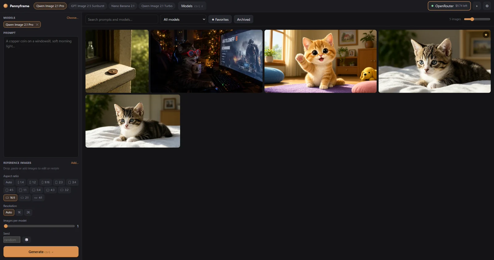

<p align="center">
  
</p>

<h1 align="center">Pennyframe</h1>

<p align="center">
  <b>Generate, compare and keep images from any OpenRouter model.</b><br>
  A fast native Windows app. One-click sign-in, switch keys and models instantly, see which model is worth its price.
</p>

<p align="center">
  <a href="https://github.com/Kollefranz/pennyframe/releases/latest"></a>
  <a href="https://github.com/Kollefranz/pennyframe/actions/workflows/ci.yml"></a>
  
  
</p>

<p align="center">
  <a href="#install">Install</a> ·
  <a href="#use-it">Use it</a> ·
  <a href="#releasing">Releasing</a> ·
  <a href="#development">Development</a>
</p>

<p align="center">
  
</p>

Go backend, [Wails v2](https://wails.io) shell (WebView2), plain HTML/CSS/JS frontend — no Node toolchain, no CGO. Works with [OpenRouter](https://openrouter.ai) image models.

## Install

Pick whichever you like; Pennyframe tells you how to update the way you installed it.

**Windows: installer.** Download `pennyframe-<version>-windows-setup.exe` from the [latest release](https://github.com/Kollefranz/pennyframe/releases/latest) and run it. It installs for your user only (no admin prompt), adds Start Menu and desktop shortcuts, and a newer installer upgrades in place. Windows may show a SmartScreen warning because the installer isn't code-signed: choose *More info → Run anyway*.

**Windows: Scoop.** This repo is also a Scoop bucket.

```powershell
scoop bucket add pennyframe https://github.com/Kollefranz/pennyframe
scoop install pennyframe/pennyframe
```

Start Menu and desktop shortcuts are created. Update with `scoop update pennyframe`; remove with `scoop uninstall pennyframe`.

**macOS: Homebrew.** This repo is also a Homebrew tap (macOS builds start with v0.3.0).

```bash
brew tap Kollefranz/pennyframe https://github.com/Kollefranz/pennyframe
brew install --cask pennyframe
```

Update with `brew update && brew upgrade --cask pennyframe`. The app is ad-hoc signed but not notarized by Apple; the cask clears the download quarantine flag so it opens normally. If you download the zip by hand instead, right-click the app and choose *Open* the first time.

Your images, settings and keys live outside the install folder, so updating or uninstalling never touches them. Windows needs the Microsoft Edge WebView2 runtime (built into Windows 11).

**Updates.** Once a day Pennyframe asks GitHub whether a newer release exists (it sends nothing but a standard request; turn it off in Settings). If there is one, an *Update* button appears with the right instruction for how you installed it: the command for Scoop or Homebrew, or a download for the installer or a manual install.

## Use it

1. Run `build/bin/pennyframe.exe`.
2. Click **Connect with OpenRouter**. Your browser opens on OpenRouter where you sign in (or create an account) and click Authorize; Pennyframe receives a key for your account (OpenRouter's OAuth PKCE flow with a one-time localhost callback — Pennyframe never sees your password). Already have a key? Use "I already have an API key". Keys are kept in the OS credential vault (Windows Credential Manager), never in a file, and you can add as many as you like.
3. Pick a model, write a prompt, **Ctrl+Enter**.

| Shortcut | Action |
| --- | --- |
| `Ctrl+K` | Model palette (search, ★ pin, tick boxes to compare) |
| `Ctrl+Enter` | Generate |
| `Alt+1…9` | Switch API key |
| `Ctrl+Shift+K` | Open the key menu (switch, add, details) |
| `←` `→` `F` | Previous / next / favorite in the viewer |
| `Ctrl`/`Shift`+click | Select several images (Shift = range); then Favorite, Archive or Delete them |
| `Ctrl+A` · `Esc` · `Del` | Select all · clear selection · delete selection |

**Quick model switching:** pinned (★) and recent models sit in the top bar; click to switch, Ctrl/Shift-click to add to a comparison. With several models selected, one prompt runs on all of them in parallel and the results land side by side.

**Live previews.** Models that support streaming show partial renders on the card as they arrive (toggle under the settings; single-image requests only). If a provider rejects streaming, the request is retried normally.

**Value chart.** In the model picker, *Value chart* plots each model's price per image against its image-arena Elo rating (Design Arena data, fetched through OpenRouter's `/benchmarks` endpoint with your key and cached for a day). Models that nothing beats on both price and rating are marked *Best value*, and one click selects a spread of them to compare. Prices you actually paid replace list prices. Only models with a flat per-image price can be plotted; token- or size-billed models appear once you've generated with them. If OpenRouter returns no ratings, the chart and rating sorts stay hidden.

**Settings adapt to the model.** Aspect ratio, resolution, quality, format, background, count, seed and compression controls come from each model's capabilities (`/api/v1/images/models`). Anything a model can't do is dropped with a note rather than failing the request.

**Archive** hides images from the main view but keeps them (and their metadata) on disk; open **Archived** in the toolbar to see or restore them. Delete removes the files permanently after a confirmation.

**Right-click and folders.** Right-click an image in the grid or the viewer to copy it, favorite, archive, delete, reuse its settings or use it as a reference; right-clicking a selected image acts on the whole selection. *Move to folder* files images into your own in-app folders (one folder per image). Folders appear as a row above the grid: click one to open it, right-click it to rename or delete it. Deleting a folder never deletes its images. Folder definitions are stored beside the images (`_folders.json`) and each image's sidecar records its folder, so they move with the image folder.

**Encrypted folders.** Tick *Encrypt this folder with a password* when creating a folder (or choose *Encrypt with a password…* on an existing one). Each encrypted folder has its own password. Its images, their thumbnails and their details (prompt, model, settings) are stored encrypted, and nothing in the folder can be seen without the password. Encrypted images appear only inside their folder, never in *All* or in search, and a locked folder shows as 🔒 with no contents. Unlock it by clicking it; *Lock* (or *Lock all*) forgets the key straight away, and every folder is locked again when Pennyframe closes. Moving an image into the folder encrypts it; moving it out writes it back unencrypted.

- **How:** AES-256-GCM with a random key per folder. That key is stored only wrapped under a key derived from your password with Argon2id (64 MiB, 3 passes), so changing the password rewraps one key and touches no image. The password is never stored. Tampered or swapped files fail to decrypt.
- **There is no recovery.** Forget the password and the images are gone. A locked folder can still be deleted along with its images (*Delete folder and its images…*).
- **Still visible on disk:** the folder's name, how many encrypted files there are, and when they were created (the file names contain a timestamp). Not hidden: anything you export with *Save as…* or copy to the clipboard is a normal, unencrypted copy.
- **Caveats:** images are generated unencrypted and sealed when you file them, and OpenRouter still receives your prompts (and any reference images) as usual. Deleted images and old unencrypted copies are overwritten before removal on a best-effort basis (and leftovers of an interrupted move are cleaned up at startup), but SSDs and journaling file systems can keep stale copies, so the strongest option is to file images straight after generating them. While a folder is unlocked, its key is in the app's memory, so this doesn't protect against malware already running as you.

Images are saved to `~/Pictures/Pennyframe` (changeable) as the original bytes plus a `.json` sidecar (prompt, model, params, cost, time, key name). Thumbnails are cached under `%APPDATA%\Pennyframe\thumbs`. Reference images (image-to-image) can be dropped, pasted, or taken from the gallery.

## Build

```bash
go test ./...
go install github.com/wailsapp/wails/v2/cmd/wails@v2.17.0
wails build -s          # icon + manifest → build/bin/pennyframe.exe
```

Plain `go build -tags desktop,production -ldflags "-H windowsgui"` also works but skips the icon/manifest.

## Releasing

```bash
git tag v0.3.0 && git push origin v0.3.0
```

The `release` workflow builds the Windows zip and installer and a universal macOS app, publishes them (plus `.sha256` files) as a GitHub release, and commits the new version and hashes to `bucket/pennyframe.json` (Scoop) and `Casks/pennyframe.rb` (Homebrew) on `main`. After that, `scoop update` / `brew upgrade` and the in-app update check pick it up.

To rehearse without publishing, run the workflow by hand (Actions → release → *Run workflow*, enter a version): it builds every package and uploads them as workflow artifacts only.

Locally: `./scripts/package-windows.ps1 -Version 0.3.0` (PowerShell 7, the wails CLI and [Inno Setup](https://jrsoftware.org/isinfo.php); `-NoInstaller` skips Inno) or `./scripts/package-macos.sh 0.3.0` on a Mac. Both write to `dist/`. `scripts/update-manifests.ps1` is what points the manifests at those files, so don't commit its changes unless you also publish those exact files.

## Development

- `OPENROUTER_BASE_URL` / `OPENROUTER_AUTH_URL` point the client at another API / sign-in page (proxy, mock).
- `PENNYFRAME_UPDATE_URL` points the update check at another "latest release" JSON endpoint (testing).
- `PENNYFRAME_DATA_DIR` uses an isolated profile (config, thumbs, `images/`).
- `go run -tags devserver .` serves the UI at http://127.0.0.1:8800 over a small RPC bridge so it can be driven in a normal browser (requires `PENNYFRAME_DATA_DIR`). File dialogs are not available there.

## Layout

```
main.go, app.go      Wails entry; bound methods (keys, models, jobs, gallery)
request.go           per-model parameter adaptation
handler.go           /img/<id> and /thumb/<id> served straight from disk
internal/openrouter  API client (models, endpoints/pricing, images, key info)
internal/store       config, keyring secrets, gallery + thumbnails
frontend/            index.html, style.css, app.js
```
